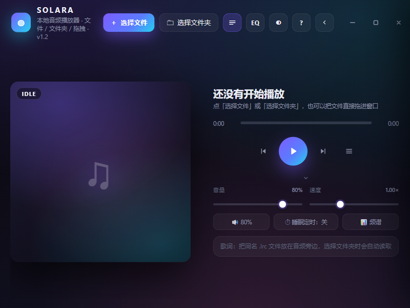

# SOLARA · 本地音频播放器

一个 Windows 单文件音频播放器：双击即用，不需要安装、不联网、不上传任何文件。
界面用 Chromium（WebView2）渲染，音频解析和文件读取在 C# 侧完成。



## 特性

**播放**
- 播放/暂停、上一首/下一首、进度拖动、音量、0.5×–2.0× 变速、静音
- 四种播放顺序：顺序 / 单曲循环 / 逆序 / 随机（不重复）
- 切歌淡入淡出，不会爆音
- 系统媒体键支持、睡眠定时（15–90 分钟）

**曲库**
- 文件多选、文件夹递归导入（含子目录）、拖拽导入
- 搜索、按标题/艺术家/专辑/时长/文件名排序、拖拽排序
- 标签读取：MP3(ID3v2) / FLAC 的标题、艺术家、专辑、年份、内嵌封面
- 无标签时按「艺术家 - 标题」解析文件名

**界面**
- 深色玻璃拟态，无边框圆角窗口，标题栏可拖动、双击最大化
- 64 段频谱 / 实时波形可视化
- 10 段均衡器（31Hz–16kHz ±12dB），9 组预设
- 同名 `.lrc` 歌词自动匹配，逐行高亮滚动
- 顶栏工具栏、底部控制面板、右侧播放列表均可折叠
- 收起播放列表时切换为横向排版（封面左、信息右）
- 明暗主题切换，状态全部持久化

## 下载

到 [Releases](../../releases) 下载 `SOLARA.exe`，双击运行。

> 首次启动会把 .NET 运行时解压到 `%TEMP%\.net`（约 200 MB 临时空间），之后复用缓存。
> 依赖系统自带的 **Microsoft Edge WebView2 Runtime**（Windows 11 内置，Windows 10 装了新版 Edge 也有）。

## 从源码构建

需要 .NET 8 SDK。

```powershell
cd app
dotnet build -c Release -t:Rebuild
dotnet publish -c Release -r win-x64 --self-contained true -o dist --no-build
```

产物：`app/dist/SOLARA.exe`（约 157 MB，单文件自包含）。

或者直接跑根目录的 `build.ps1`。

## 架构

```
web/player.html     前端：单文件 HTML/CSS/JS，作为嵌入资源打进 exe
app/MainForm.cs     无边框窗口 + WebView2 初始化 + 资源路由 + 窗口消息桥
app/HostBridge.cs   原生文件/文件夹选择器、目录扫描、媒体 Range 路由、封面路由
app/MediaInfo.cs    C# 侧标签与时长解析（ID3v2 / FLAC / WAV / MPEG）
app/NativeMethods.cs Win32 调用（拖动窗口、圆角、SetWindowPos）
app/Program.cs      入口、异常兜底、TEMP 可写性探测
```

### 几个关键设计

**页面不直接读文件**

页面运行在 `https://app.local/` 这个虚拟源下，所有本地文件通过自建路由访问：

```
https://app.local/f?p=<base64路径>     音频流，支持 HTTP Range（可拖动进度）
https://app.local/cover?p=<base64路径>  内嵌封面
```

C# 侧在 `OnWebResourceRequested` 里拦截并返回文件流，响应带 `Content-Length` 和 `Content-Range`。
只放行用户通过系统对话框亲手选中的文件，其他路径一律 403。

**标签和时长在 C# 里解析**

早期版本让浏览器为每首歌 `fetch` 标签、用 `new Audio()` 探测时长，800 首时媒体栈直接被占满，
列表卡死、播放失败。现在扫描目录时 C# 直接读文件头解析：

- MP3：ID3v2 帧 + Xing 头或帧头比特率
- FLAC：STREAMINFO + VORBIS_COMMENT + PICTURE
- WAV：fmt / data chunk

800 首实测：扫描 269 ms，列表 0.5 秒全部就绪，UI 零长任务。

**播放优先**

点击播放时暂停后台的标签/时长队列 1.5 秒，避免和音频抢带宽。

## 快捷键

| 操作 | 按键 |
| --- | --- |
| 播放 / 暂停 | `空格` |
| 快退 / 快进 5 秒 | `← →` |
| 快退 / 快进 30 秒 | `Shift + ← →` |
| 音量 ±5% | `↑ ↓` |
| 上一首 / 下一首 | `P` / `N` |
| 静音 | `M` |
| 播放顺序（顺序/单曲/逆序/随机） | `S` |
| 搜索 | `/` |
| 收起 / 展开列表 | `B` |
| 收起 / 展开控制面板 | `X` |
| 收起 / 展开顶部工具栏 | `F` |
| 均衡器 | `E` |
| 频谱 / 波形 | `V` |
| 明暗主题 | `T` |
| 删除当前曲 | `Del` |
| 帮助面板 | `H` |

## 已知限制

- 播放列表不跨次保存（浏览器内核不保留文件句柄），但音量、速度、均衡器、主题、折叠状态、播放顺序会记住
- 自包含单文件首次启动需要可写的临时目录；`%TEMP%` 不可写时程序会退回自身目录
- exe 未签名，个别杀软可能误报，加白名单即可

## License

MIT
